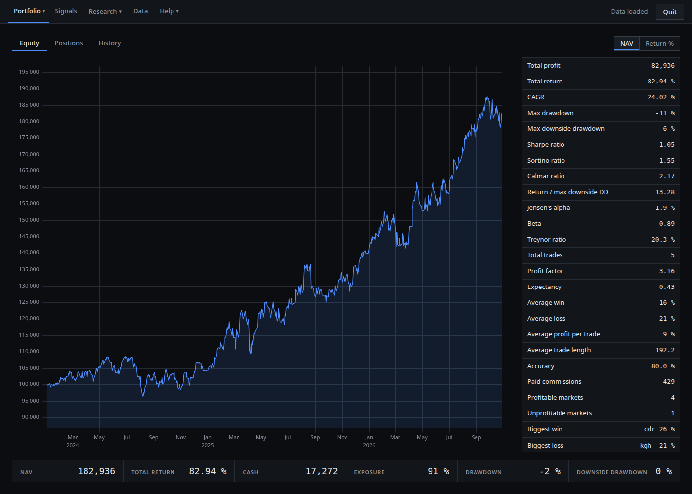
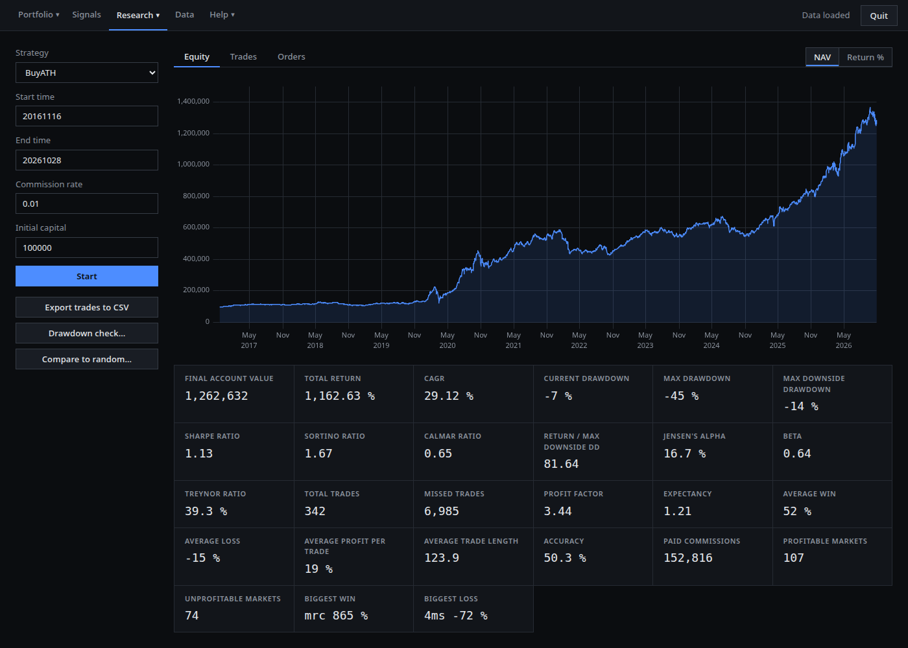
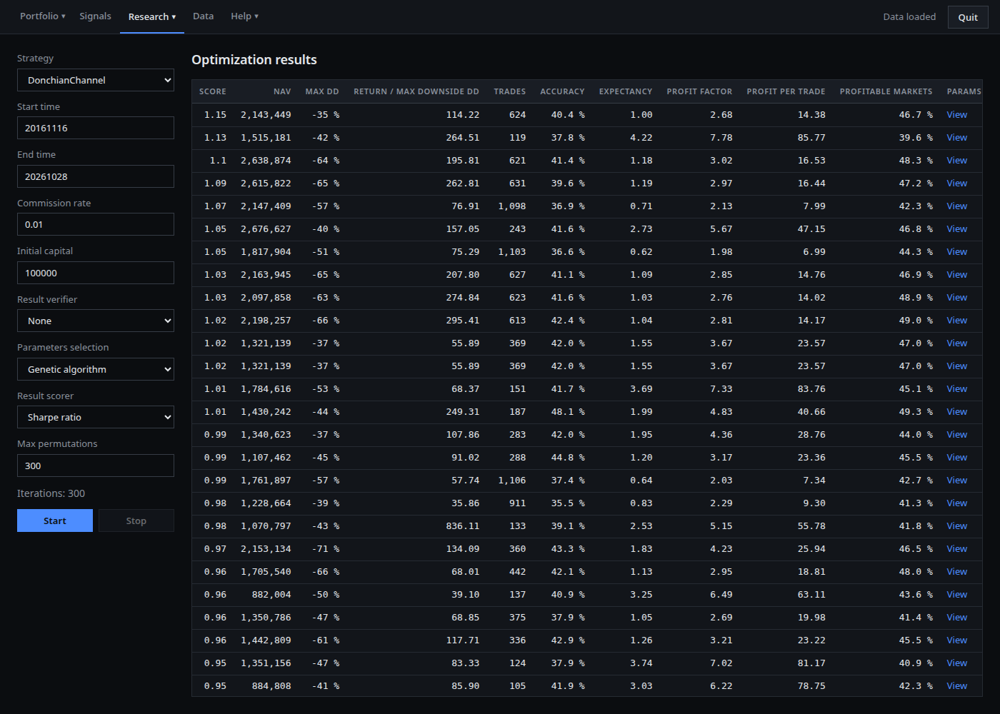
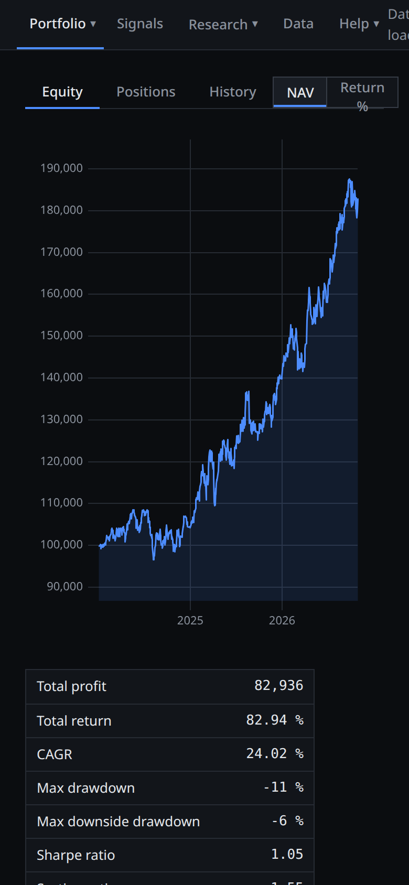

# Alis – Algorithmic Investing Software

Alis helps you research trading strategies and track your own portfolio.
It has two parts:

- **Alis Studio** – an app that runs in your web browser. No coding needed.
- **Alis library** – Java building blocks for your own strategies, backtests and research.



## What you can do

- **Portfolio** – log your trades and cash. See equity, open positions and over 20 statistics: CAGR, drawdowns, Sharpe, Sortino, alpha, beta and more.
- **Signals** – see a strategy's buy and sell signals since a given date, or only for your portfolio.
- **Backtest** – test a strategy on historical data. See the equity curve, every trade and every order.
- **Compare to random** – check how often random trading beats your strategy. Random trades get the same count, holding lengths and exposure.
- **Drawdown check** – see how unusual the current drawdown is, by depth and by length, compared with past ones.
- **Optimization** – search strategy parameters: full permutation, genetic algorithm or random. Rank results by CAGR, Sharpe, Calmar, Jensen's alpha and other scores. Check robustness with verifiers (remove markets, remove orders, fuzzy start time).
- **Better exits** – load your trade log and test exit rules on it: trailing stop, SMA, time in position and others.
- **Data** – free daily data from [Stooq.pl](https://stooq.pl/db/h/): Polish (GPW) and US markets.

## Highlights

**Runs in the browser.** Studio is a single JAR with a web GUI.
It works on a desktop and on a phone screen.
It works offline: all scripts and fonts are inside the JAR.

**Jobs run in the background.** Backtests and optimizations run in Studio, not in the browser.
Close the tab, open it later, and the job is still there with its results.

**Risk-adjusted statistics.** Portfolio and backtest show Sharpe, Sortino and Calmar ratios,
return / max downside drawdown, Jensen's alpha, beta and Treynor ratio.
The risk-free rate is the NBP reference rate, built in from 1998. The benchmark is WIG.
The same measures can be used as optimization scores.
Details: [metryki-rf/README.md](metryki-rf/README.md) (in Polish).



**Realistic backtests.**
- Fractional shares.
- Delisted stocks: open positions are sold at the delisting price, without commission.
- One trade is a full round trip, from entry to exit.
- Downside drawdown is measured from the highest closed equity. Giving back unrealized profit is not a drawdown.



Change history: [ChangeLog.txt](ChangeLog.txt).

## Run on a server, use from your phone

Studio is a small web server. You can run it on a home server or a VPS
and use it from a laptop or a phone.
Long optimizations keep running on the server when you close the browser.



1. Start Studio on the server:
   ```
   java -Djava.awt.headless=true -jar studio.jar --no-browser
   ```
2. Studio listens only on `127.0.0.1:7070` and has no login. Do not open this port to the internet.
   Connect through an SSH tunnel instead:
   ```
   ssh -L 7070:127.0.0.1:7070 user@your-server
   ```
   Use the same port number on both sides. Studio rejects requests for any other port.
   On Android you can run the same command in Termux. On iOS use an SSH app with port forwarding.
3. Open `http://localhost:7070` in the browser on your laptop or phone.

To get market data on the server, copy the Stooq ZIP file to `~/Downloads` on the server
and click **Data → Unzip downloaded**, then **Load PL** or **Load US**.

Note: **Quit** in the top bar stops Studio on the server.

## Getting started

Requirements: Java 21. Building also needs Maven and Node.js (npm).

Build and run:
```
./build-gui.sh -DskipTests
java -jar studio/target/studio-1.0-SNAPSHOT-jar-with-dependencies.jar
```

Studio opens in your browser at `http://127.0.0.1:7070`.
Options: `--no-browser` (do not open a browser), `--port=8080` (another port).

First run:
1. Accept the license.
2. Go to **Data → Open Stooq.pl** and download daily data (ASCII, e.g. `d_pl_txt.zip`).
3. Click **Unzip downloaded**, then **Load PL** or **Load US**.

Studio keeps its files in `~/Alphatica`: data, your portfolio (`account.csv`) and risk-free rates (`rf/`).

Installers: `build-linux.sh` builds an AppImage, `build-windows.bat` builds a Windows app.

GUI development with hot reload: start the JAR with `--no-browser`,
then run `npm run dev` in `studio/frontend` and open `http://localhost:5173`.

## Library

Modules:
- `alis` – the library: market data, indicators, accounts, backtesting, optimization, data mining.
- `studio-core` – Studio logic without the GUI.
- `studio` – the web server and the GUI (`studio/frontend`, SolidJS).
- `examples` – sample research code, see [examples/README.md](examples/README.md).

Main features:
- portfolio statistics,
- strategy backtesting,
- drawdown analysis,
- parameter optimization,
- alpha verification,
- data mining for better portfolios and strategies.

### Signal research

`SignalExecutor` finds signals once and stores every possible trade (`TradeOpportunity`)
in an immutable `SignalExecutionResult`.
`AllocationReplayer` then replays this result for any capital limit (`maxAllocation`),
with `STOP_ON_FIRST_REJECTION` or `PARTIAL_LAST_POSITION`. Indicators are not computed again.

- A buy signal returns `Optional<BuySignal>`.
- `requestedAllocation` is a normalized unit of capital.
- `priority` only ranks signals from the same session.
- `ScoreCalculator` scores a result. Built in: allocation-weighted profit per bar and capacity-adjusted score.
- `AllocationScorer` builds a score curve for many capital limits at once.

## Status

Alis is in active development. A GitHub star is much appreciated!

## License

GNU AGPL 3.0. A commercial license is available on request: [license@alphatica.com](mailto:license@alphatica.com).

## Bugs and feature requests

Report bugs to [lw@alphatica.com](mailto:lw@alphatica.com).
Request features at [alphatica.com/feature-request/new](https://alphatica.com/feature-request/new/).

More research and articles: [alphatica.com](https://alphatica.com/).
