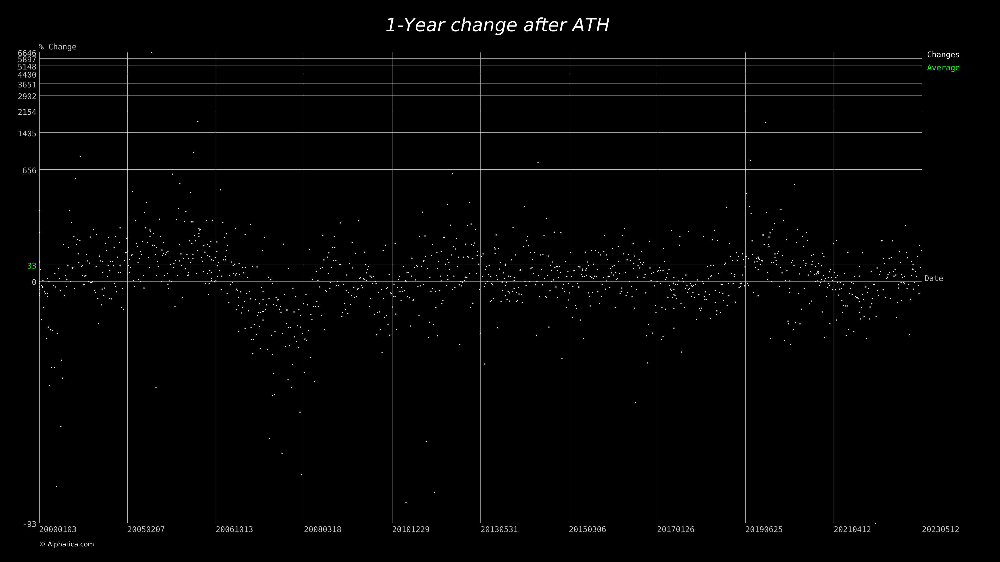

# Checks on current market data

## Price change after an all-time high

[Source](./src/main/java/com/alphatica/alis/examples/changecheck/AllTimeHighChangeCheck.java)

What happens to a stock in the year after it reaches an all-time high?
The program measures the average one-year change.

Results for 2000-01-01 – 2023-05-12:

```
Average: 29.4
Median: -2.9
Time average: 31.3
Count: 17282
```

Without overlapping periods:

```
Average: 33.4
Median: 55.7
Time average: 34.7
Count: 1191
```



## Current Min-Max values

[Source](./src/main/java/com/alphatica/alis/examples/minmax/MinMaxNow.java)

Min-Max shows long-term trends. It is similar to a simple moving average, but gives fewer false signals.
More about the indicator: [alphatica.com/pl/blog/min-max](https://alphatica.com/pl/blog/min-max/)
